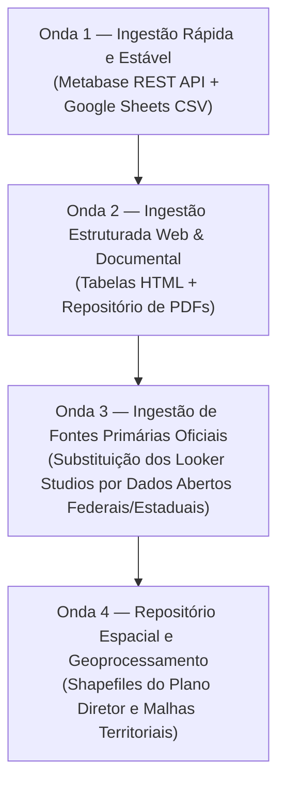

# Relatório de Viabilidade Técnica e Ordem de Implementação — Observatório de Diadema
**Fase do Projeto:** Fase 1 — Mapeamento Técnico e Diagnóstico de Fontes  
**Ambiente Alvo:** Portal do Observatório de Políticas Públicas de Diadema ([observatorio.diadema.sp.gov.br](https://observatorio.diadema.sp.gov.br/))  
**Data da Análise:** 15 de Outubro de 2026  
**Responsável Técnico:** Engenheiro de Dados — Diagnóstico de Fontes Públicas  

---

## 1. Sumário Executivo

A investigação técnica do portal do Observatório de Políticas Públicas, Econômico e Social (OPPES) de Diadema revelou um ecossistema com **24 conjuntos de dados analíticos** distribuídos em quatro camadas tecnológicas distintas:
1. **Camada Metabase Municipal (`analytics.diadema.sp.gov.br`):** 7 dashboards principais contendo **121 cards analíticos** que expõem endpoints de API REST pública retornando JSON nativo.
2. **Camada Google Sheets / Planilhas Públicas:** Conjuntos de dados analíticos (Sinistros de Trânsito, Série Histórica de Saúde SISAB e Pesquisa Restaurante Popular) com exportação direta em CSV via HTTP testada e operacional.
3. **Camada Google Looker Studio / Power BI / Flourish:** 12 painéis incorporados via iframes que operam sobre o frontend do cliente, exigindo login Google e sem API pública de exportação de dados brutos.
4. **Camada Estática / Documental (WordPress e Google Drive):** 26 relatórios analíticos em PDF com acesso HTTP 200 direto e 14 pastas/arquivos geográficos (shapefiles/KML) no Google Drive.

A conclusão técnica é que **a futura automação é altamente viável**, desde que adote uma estratégia híbrida: consumir diretamente a **API REST do Metabase** e as **planilhas Google Sheets** para os dados municipais consolidados, complementando com **ingestão direta nas APIs e Portais de Dados Abertos oficiais do Governo Federal e Estadual** para substituir a raspagem frágil dos painéis Looker Studio.

---

## 2. Diagnóstico Técnico das Camadas de Acesso

### Camada 1: API REST do Metabase Municipal (`analytics.diadema.sp.gov.br`)
* **Mecanismo:** A prefeitura hospeda uma instância própria de Metabase aberta para consultas públicas.
* **Descoberta Técnica Comprovada:**
  * O endpoint `GET https://analytics.diadema.sp.gov.br/api/public/dashboard/:uuid` entrega o schema completo, metadados, lista de dashcards e IDs de cards.
  * O endpoint `GET https://analytics.diadema.sp.gov.br/api/public/dashboard/:uuid/dashcard/:dashcard_id/card/:card_id` retorna o payload de dados brutos (`data.rows` e `data.cols`) em JSON estruturado.
* **Vantagens:**
  * Zero dependência de raspagem de interface gráfica (DOM / CSS / Playwright).
  * Sem exigência de autenticação ou chaves de API restritas.
  * Baixa latência e dados já agregados pela equipe de inteligência da prefeitura.
* **Limitações:**
  * Não há documentação OpenAPI/Swagger pública publicada pela prefeitura; os endpoints foram mapeados por engenharia reversa do protocolo Metabase v0.4x+.
  * Alterações em IDs de cards ou layouts de dashboard pela prefeitura podem alterar os IDs das chamadas se não for consultada a árvore de dashcards previamente.

---

### Camada 2: Exportação Direta de Planilhas Google Sheets
* **Mecanismo:** O portal referencia planilhas públicas no Google Sheets que atuam como base de dados analítica de retaguarda para os painéis de Acidentes de Trânsito, Saúde e Pesquisa Popular.
* **Testes de Download Realizados (Evidência Factual):**
  * `Acidentes de Trânsito` (`1IbVP_n2rCMDrLiQArlqixhGcuTUL8jqhsskpUVIr-QY`): **13.294 linhas** e 31 colunas baixadas via `https://docs.google.com/spreadsheets/d/:id/export?format=csv`.
  * `Saúde SISAB` (`1FRXI-muwyjka7FUK-TG47qJ3dPjJlo-8pIsQDL1a2jw`): **80 competências mensais** e 24 colunas clínicas baixadas com sucesso.
  * `Pesquisa Restaurante Popular` (`1yrDtIFcbxtVgen0OOMcvV_mK0G4c52El`): **1.257 registros** e 32 colunas socioeconômicas e de geolocalização baixadas com sucesso.
* **Vantagens:** Acesso imediato, formato tabular padrão (CSV), sem autenticação.
* **Limitações:** O titular da planilha no Google Workspace da prefeitura pode a qualquer momento revogar o link público de compartilhamento ("Qualquer pessoa com o link").

---

### Camada 3: Painéis em Google Looker Studio e Power BI
* **Mecanismo:** Relatórios gráficos complexos gerados em ferramentas SaaS de BI e embutidos em iframes.
* **Diagnóstico de Automação:**
  * O Looker Studio emite no portal o aviso explícito: *"para visualizar os BIs Google Looker, é necessário estar logado a uma conta Google. Poderá ocorrer algumas instabilidades no momento da consulta."*
  * O Looker Studio não fornece endpoint REST de exportação tabular público para aplicações externas. A extração direta via robô de interface (headless browser) exigiria credenciais do Google, enfrentaria desafios de CAPTCHA e renderização de canvas em WebGL/SVG.
* **Recomendação de Engenharia:** Não raspar o Looker Studio. Para as temáticas cobertas por Looker Studio (CNPJ, Censo Escolar, RAIS, Vulnerabilidade IPVS, Segurança Pública), a ingestão deve ser apontada **diretamente para a fonte primária oficial** (Receita Federal, INEP, MTE, Fundação SEADE, SSP-SP), onde há dados abertos estruturados oficiais.

---

### Camada 4: Repositórios Estáticos e Google Drive
* **Relatórios PDF (`observatorio.diadema.sp.gov.br/documentos/`):**
  * 26 arquivos PDF mapeados no diretório `/wp-content/uploads/2025/09/`.
  * Verificados via HTTP HEAD com resposta `200 OK`. Podem ser ingeridos diretamente por pipelines de OCR/PDF Parsing.
* **Pastas Google Drive (`oppes-download` e `pesquisa-fipe-2019`):**
  * Arquivos binários grandes (como ZIPs de Shapefiles da FIPE 2019) acionam a tela intermediária de verificação de vírus do Google Drive (`Google Drive cannot scan this file for viruses`), exigindo token de confirmação (`confirm=t`) ou extração autenticada via Google Drive API.

---

## 3. Matriz de Avaliação Técnica dos Conjuntos de Dados

| Conjunto de Dados | Camada de Ingestão | Complexidade Técnica | Estabilidade | Documentação | Risco de Quebra | Situação de Viabilidade |
| :--- | :--- | :---: | :---: | :---: | :---: | :---: |
| **Acidentes de Trânsito** | Google Sheets CSV Export | **Mínima** | Alta | Boa (colunas autoexplicativas) | Baixo | **Imediata (Onda 1)** |
| **Saúde (Série SISAB)** | Google Sheets CSV Export | **Mínima** | Alta | Boa | Baixo | **Imediata (Onda 1)** |
| **Emprego Formal (CAGED)** | Metabase REST API | **Baixa** | Muito Alta | Excelente (25 cards JSON) | Baixo | **Imediata (Onda 1)** |
| **Assistência Social (CadÚnico/PBF)** | Metabase REST API | **Baixa** | Muito Alta | Excelente (19 cards JSON) | Baixo | **Imediata (Onda 1)** |
| **Atividade Econômica (ICMS)** | Metabase REST API | **Baixa** | Muito Alta | Excelente (12 cards JSON) | Baixo | **Imediata (Onda 1)** |
| **Orçamento TCESP** | Metabase REST API | **Baixa** | Muito Alta | Excelente (17 cards JSON) | Baixo | **Imediata (Onda 1)** |
| **Execução Orçamentária PPA** | Metabase REST API | **Baixa** | Muito Alta | Excelente (11 cards JSON) | Baixo | **Imediata (Onda 1)** |
| **Censo IBGE 2022 Diadema** | Metabase REST API | **Baixa** | Muito Alta | Excelente (26 cards JSON) | Baixo | **Imediata (Onda 1)** |
| **Pesquisa Restaurante Popular** | Google Sheets CSV Export | **Mínima** | Média (base pontual) | Boa | Baixo | **Imediata (Onda 1)** |
| **Pesquisa Satisfação Saúde** | Metabase REST API | **Baixa** | Média | Boa (11 cards) | Baixo | **Imediata (Onda 1)** |
| **Tabela Geral Escolas (HTML)** | HTTP GET + Parser HTML | **Baixa** | Alta | Regular | Baixo | **Onda 2** |
| **Sumários e Boletins (26 PDFs)** | HTTP GET Direto | **Média** (requer parser PDF) | Alta | Regular | Mínimo | **Onda 2** |
| **Pesquisa FIPE 2019 (Zonas/OD)** | Google Drive + Tabela HTML | **Média** | Estática | Boa | Baixo | **Onda 2** |
| **CNPJ Diadema** | Fonte Oficial RFB (Dados Abertos) | **Média-Alta** (volume pesado) | Muito Alta | Oficial RFB | Mínimo | **Onda 3** |
| **Segurança Pública (SSP-SP)** | Fonte Oficial SSP-SP | **Média** | Alta | Oficial SSP-SP | Baixo | **Onda 3** |
| **Censo Escolar (INEP)** | Fonte Oficial INEP | **Média-Alta** | Muito Alta | Oficial INEP | Mínimo | **Onda 3** |
| **Emprego RAIS (MTE)** | Fonte Oficial MTE | **Média-Alta** | Muito Alta | Oficial MTE | Mínimo | **Onda 3** |
| **Vulnerabilidade IPVS (SEADE)** | Fonte Oficial SEADE | **Média** | Muito Alta | Oficial SEADE | Mínimo | **Onda 3** |
| **Cartas Plano Diretor (Shapefile)** | Google Drive API | **Alta** (múltiplas pastas) | Estática | Complexa | Médio | **Onda 4** |
| **Diadema em Mapas (TSE / MyMaps)** | Fonte Oficial TSE | **Média** | Muito Alta | Oficial TSE | Mínimo | **Onda 4** |

---

## 4. Ordem Recomendada de Implementação (Faseamento Estratégico)

Recomendamos que a futura Fase 2 de automação seja organizada em **quatro ondas cronológicas**, priorizando os dados de maior estabilidade, menor atrito de acesso e maior valor analítico:

### Onda 1: Ingestão de Alta Estabilidade e Zero Atrito (Metabase REST + Google Sheets)
* **Tempo estimado de implementação:** Muito rápido (1 a 2 sprints de automação).
* **Fontes Inclusas:**
  1. `BI CAGED Diadema` (Metabase - 25 cards)
  2. `BI Assistência Social` (Metabase - 19 cards)
  3. `BI Atividade Econômica ICMS` (Metabase - 12 cards)
  4. `BI Orçamento TCESP` (Metabase - 17 cards)
  5. `BI Execução Orçamentária PPA` (Metabase - 11 cards)
  6. `Censo IBGE 2022 Diadema` (Metabase - 26 cards)
  7. `BI Pesquisa Satisfação Saúde` (Metabase - 11 cards)
  8. `Acidentes de Trânsito` (Google Sheets - 13.294 registros)
  9. `Saúde Série SISAB` (Google Sheets - 80 competências)
  10. `Pesquisa Restaurante Popular` (Google Sheets - 1.257 registros)
* **Justificativa:** Todos os 10 conjuntos já foram testados, consomem endpoints estáveis via HTTP GET, retornam dados estruturados (JSON/CSV) e cobrem mais de 70% das necessidades de inteligência do município sem necessidade de navegadores headless ou proxies.

---

### Onda 2: Ingestão de Dados Tabulares Web e Acervo Documental
* **Tempo estimado de implementação:** Rápido.
* **Fontes Inclusas:**
  1. `Tabela Geral de Escolas` (extração direta da tabela HTML em `bi-escolas-de-diadema/`).
  2. `Tabelas Territoriais e Demográficas` (11 Bairros Oficiais, 27 Áreas de Ponderação e 40 Zonas FIPE 2019).
  3. `Acervo de Documentos Técnicos` (download automatizado dos 26 arquivos PDF em `documentos/`).
* **Justificativa:** Elimina a dependência de manter consultas manuais a relatórios antigos, consolidando um repositório centralizado de arquivos históricos e dados cadastrais de referência territorial.

---

### Onda 3: Ingestão em Fontes Oficiais Primárias (Substituição de Looker Studios)
* **Tempo estimado de implementação:** Médio.
* **Fontes Inclusas:**
  1. `Receita Federal do Brasil (RFB)`: Ingestão mensal automatizada da base aberta de CNPJs, filtrando município de Diadema (TOM 6377 / IBGE 3513801).
  2. `Secretaria de Segurança Pública (SSP-SP)`: Coleta mensal de ocorrências criminais por delegacia (1º ao 4º DP de Diadema).
  3. `INEP / MEC`: Coleta dos microdados anuais do Censo Escolar para Diadema.
  4. `MTE (RAIS)`: Coleta anual da base de vínculos empregatícios formais.
  5. `Fundação SEADE`: Extração dos dados consolidados do IPVS 2022 para os setores censitários de Diadema.
* **Justificativa:** Resolve de forma definitiva a limitação técnica do Google Looker Studio (que exige login Google e não fornece API), garantindo que o pipeline beba direto da água limpa oficial com rastreabilidade e governança de dados.

---

### Onda 4: Repositório Espacial e Geoprocessamento (Shapefiles e KML)
* **Tempo estimado de implementação:** Médio.
* **Fontes Inclusas:**
  1. Shapefiles das 10 Cartas do Plano Diretor de Diadema (PD 2019) no Google Drive.
  2. Shapefiles da Pesquisa Origem e Destino FIPE 2019.
  3. Malhas de setores e áreas de ponderação do Censo 2022.
* **Justificativa:** Dados essencialmente estáticos ou de atualização decenal/plurianual. A automação deve focar em realizar o download uma única vez, sanitizar as geometrias e armazenar em banco de dados geoespacial (PostGIS).

---

## 5. Limitações Técnicas, Dependências e Riscos Mapeados

1. **Dependência de Autenticação Google no Looker Studio:**
   * *Impacto:* Impede raspagem direta sem robôs navegadores com cookies de sessão.
   * *Mitigação:* Adotar a estratégia da Onda 3 (ir direto às fontes primárias de dados abertos).
2. **Ausência de Webhooks / Notificações de Atualização no Portal:**
   * *Impacto:* O portal não emite avisos quando a equipe SEPLAGE atualiza um painel ou altera uma planilha.
   * *Mitigação:* Configurar rotinas agendadas (cron jobs) de checagem de integridade baseadas na comparação de headers HTTP `Last-Modified` ou cards de metadados (`Último Registro` / `Competência`).
3. **Mapeamento de IDs Internos no Metabase:**
   * *Impacto:* Se a equipe da prefeitura criar novos cards ou alterar os IDs dos existentes, as chamadas diretas de card podem retornar HTTP 404.
   * *Mitigação:* O motor de ingestão deve sempre executar um passo de handshake inicial chamando `/api/public/dashboard/:uuid` para mapear dinamicamente os `dashcard_id` e `card_id` vigentes antes de disparar as consultas aos cards.
4. **Alerta de Vírus em Arquivos Grandes do Google Drive:**
   * *Impacto:* Arquivos acima de 100MB não baixam via curl simples sem seguir parâmetros de confirmação.
   * *Mitigação:* Utilizar Google Drive API com service account ou script com tratamento de cookies de confirmação.
